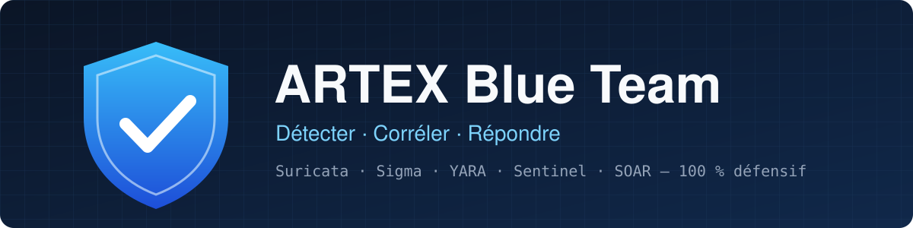
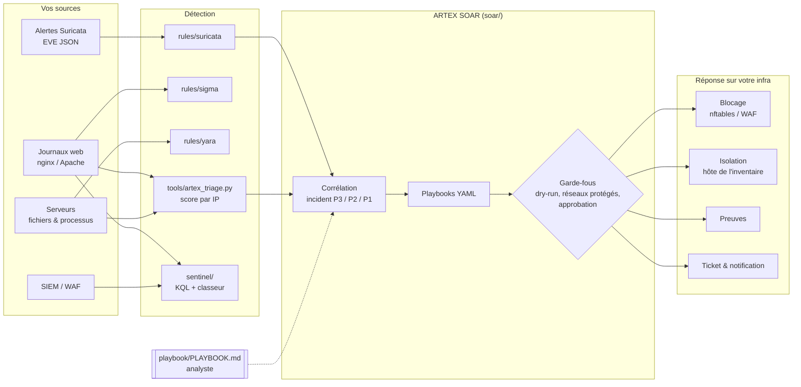

<p align="center">
  
</p>

<p align="center">
  <b>Le kit défensif pour repérer, qualifier et contenir les attaques menées avec ARTEX.</b><br>
  Règles prêtes à l'emploi, script de triage, playbook de réponse, intégration Microsoft Sentinel
  et plateforme SOAR, le tout en dry-run par défaut.
</p>

<p align="center">
  <a href="https://github.com/prevaljacket-dev/blue-team-against-artex/actions/workflows/soar-tests.yml"></a>
  <a href="https://github.com/prevaljacket-dev/blue-team-against-artex/actions/workflows/sentinel.yml"></a>
  
  
  
  
  
  
</p>

<p align="center">
  <a href="#-démarrage-rapide">Démarrage rapide</a> ·
  <a href="#-exemple-de-résultat">Exemple</a> ·
  <a href="#-architecture">Architecture</a> ·
  <a href="#-fonctionnalités">Fonctionnalités</a> ·
  <a href="#-structure-du-dépôt">Structure</a> ·
  <a href="#-sécurité-et-limites">Sécurité</a>
</p>

---

## 🎯 Pourquoi ce projet

[ARTEX](https://github.com/BaaRai/ARTEX) est une plateforme de test d'intrusion autonome pilotée
par un LLM : elle enchaîne reconnaissance, scan et exploitation avec de vrais outils (nmap, ffuf,
sqlmap, nuclei, Playwright…). Utilisée sans autorisation contre votre infrastructure, elle laisse
pourtant des traces très reconnaissables.

**ARTEX Blue Team** transforme ces traces en détections et en réponses concrètes :

- 🔎 **Détecter** ARTEX au niveau réseau, journaux web, fichiers et processus.
- 🧮 **Qualifier** chaque source par un score d'attaque et une priorité P3 / P2 / P1.
- 🛡️ **Répondre** avec un playbook clair et des actions automatisées, toujours sur *votre*
  infrastructure, avec garde-fous et approbation humaine.
- ☁️ **S'intégrer** à Microsoft Sentinel ou à tout SIEM compatible Sigma.

> [!IMPORTANT]
> Ce dépôt est **strictement défensif**. Aucun composant ne scanne, ne contacte ou n'attaque la
> source. Les actions (blocage, isolation, preuves, ticket) ne visent que vos propres systèmes et
> sont simulées (`dry_run`) tant que vous ne les activez pas explicitement.

## 🚀 Démarrage rapide

Il suffit de Python 3.9 ou plus récent. Le script de triage n'a besoin d'aucune dépendance.

```bash
git clone https://github.com/prevaljacket-dev/blue-team-against-artex.git
cd blue-team-against-artex

# 1. Tester le triage sur le journal d'exemple fourni
python3 tools/artex_triage.py logs samples/access_demo.log

# 2. Rejouer le même journal dans le SOAR (simulation, aucun effet de bord)
cd soar
pip install -r requirements.txt
python -m artex_soar replay ../samples/access_demo.log --target web01
```

<details>
<summary><b>Utiliser le kit sur vos propres journaux et serveurs</b></summary>

```bash
# Scorer les IP de vos journaux web et produire un rapport JSON
python3 tools/artex_triage.py logs /var/log/nginx/access.log* --json triage.json

# Chasser les IOC (sessions PHP piégées, webshells, binaire ARTEX) sur un serveur
sudo python3 tools/artex_triage.py host --webroot /var/www --json host.json

# Valider et utiliser les règles
suricata -T -S rules/suricata/artex.rules
yara -r rules/yara/artex.yar /var/lib/php/sessions /var/www
sigma convert -t splunk --without-pipeline rules/sigma/   # ou -t lucene, etc.
```

Le script renvoie le code `2` si une source CRITIQUE/ELEVE ou un IOC hôte est trouvé, `0` sinon :
pratique en tâche planifiée ou dans un pipeline.

</details>

<details>
<summary><b>Lancer la plateforme SOAR avec Docker Compose</b></summary>

```bash
cd soar
cp .env.example .env          # changez SOAR_API_KEY
docker compose up -d --build
# Tableau de bord : http://127.0.0.1:8080 (saisir la clé API)

curl -X POST -H "X-API-Key: $SOAR_API_KEY" --data-binary @../samples/access_demo.log \
     "http://127.0.0.1:8080/api/v1/ingest/access-log?target=web01"
```

Détails, API et passage en mode réel : [`soar/README.md`](soar/README.md) et
[`soar/docs/DEPLOIEMENT.md`](soar/docs/DEPLOIEMENT.md).

</details>

## 📟 Exemple de résultat

Sortie **réelle** des deux commandes du démarrage rapide sur `samples/access_demo.log` (journal
synthétique : un visiteur légitime et une source qui enchaîne ffuf, sqlmap, LFI puis inclusion de
session PHP).

**Triage** (`tools/artex_triage.py logs`) :

```text
== Sources suspectes : 1 (lignes non parsees : 0) ==

[CRITIQUE] 198.51.100.66  score=445  requetes=305  pic=300/10s  4xx=0.99
  periode : 2026-11-24T10:00:00+00:00 -> 2026-11-24T10:00:24+00:00
  ATT&CK  : T1036, T1190, T1595, T1595.003
   - UA: ffuf (300)
   - Charge: LFI / traversee (2)
   - UA: client HTTP script (2)
   - UA: ARTEX-Assessment (identifiant ARTEX) (1)
   - UA: sqlmap (1)
   - Charge: SQLi (1)
   - UA: Chromium headless (Playwright) (1)
   - Charge: inclusion de session PHP (php2shell) (1)
   - Rafale: 300 req/10s (1)
   - Enumeration de chemins (forte proportion de 404/403) (1)
   - Rotation de User-Agent: 5 UA distincts (1)
```

**SOAR** (`python -m artex_soar replay`, extrait) :

```text
== 1 incident(s), mode dry_run ==

[P1 ARTEX] INC-4b2da5b5a5 198.51.100.66 score=445 etape=execution statut=open evenements=305
   > p3-artex-confirme: block_ip via nftables -> dry_run (simulation : commandes non executees)
       $ nft add element inet filter artex_soar_block { 198.51.100.66 timeout 86400s }
   > p2-exploitation: block_ip via nftables -> dry_run (simulation : commandes non executees)
       $ nft add element inet filter artex_soar_block { 198.51.100.66 timeout 604800s }
   > p1-compromission: collect_evidence via evidence -> dry_run (simulation : preuves dans data/evidence/…)
   > p1-compromission: isolate_host via isolation -> blocked_by_guard (web01 n'est pas dans l'inventaire (inventory.hosts) : isolation refusee)
```

Ce qu'il faut retenir : la source est classée **P1 (compromission probable)**, le blocage pare-feu
est préparé mais seulement simulé, et l'isolation du serveur est **refusée par un garde-fou** tant
que `web01` n'est pas déclaré dans l'inventaire. Le visiteur légitime `192.0.2.10` ne déclenche rien.

## 🧭 Architecture



Le même jeu de signatures sert partout : le SOAR réutilise celles d'`artex_triage.py`, et la règle
Sentinel « score d'attaque » reprend le même calcul. Une détection ajoutée à un endroit se retrouve
donc cohérente dans les autres. Détails : [`soar/docs/ARCHITECTURE.md`](soar/docs/ARCHITECTURE.md).

## ✨ Fonctionnalités

| Module | Ce qu'il apporte | Validé avec |
|---|---|---|
| 🌐 **Suricata** · [`rules/suricata/artex.rules`](rules/suricata/artex.rules) | 21 règles réseau : User-Agents ARTEX, en-têtes internes `X-ARTEX-*`, outils embarqués, php2shell, LFI, callbacks OAST, rafales. | Suricata 7.0.3 |
| 📜 **Sigma** · [`rules/sigma/`](rules/sigma/) | 6 règles (journaux web et création de processus) convertibles vers Splunk, Elastic, QRadar, etc. | pySigma |
| 🧬 **YARA** · [`rules/yara/artex.yar`](rules/yara/artex.yar) | 3 règles : sessions PHP piégées, webshells, binaire et configuration ARTEX. | yara-python |
| 🧮 **Triage** · [`tools/artex_triage.py`](tools/artex_triage.py) | `logs` : score d'attaque par IP avec techniques MITRE ATT&CK. `host` : chasse aux IOC sur un serveur. Bibliothèque standard uniquement. | Journal d'exemple |
| 📘 **Playbook** · [`playbook/PLAYBOOK.md`](playbook/PLAYBOOK.md) | Préparation, détection, confinement, éradication, retour d'expérience, cartographie ATT&CK. | — |
| ☁️ **Microsoft Sentinel** · [`sentinel/`](sentinel/README.md) | 11 règles d'analyse KQL, 4 requêtes de chasse, un classeur, un modèle ARM déployable en une fois. | CI `sentinel.yml` |
| 🤖 **ARTEX SOAR** · [`soar/`](soar/README.md) | API, corrélation en incidents, playbooks YAML, connecteurs pare-feu / WAF / isolation / preuves / ticket / notification, tableau de bord, audit, Docker Compose. | CI `soar-tests.yml` (19 tests) |

### Ce que le kit reconnaît chez ARTEX

| Signal | Exemple | Résiste à un changement d'UA ? |
|---|---|---|
| Identifiants explicites | UA `ARTEX-Assessment/1.0`, `artex-update-check`, en-têtes `X-ARTEX-Replay-Nonce`, `X-Artex-Hook` | ❌ |
| Outils embarqués | ffuf, sqlmap, nmap, nuclei, dalfox, hydra, Chromium headless | ❌ |
| Charges d'attaque | SQLi, XSS, LFI / traversée, inclusion de `sess_*` (php2shell) | ✅ |
| Comportement | rafales, énumération (404/403), rotation d'UA, callbacks OAST | ✅ |
| Traces sur l'hôte | sessions PHP piégées, webshells, instance ARTEX (ports 8787/8788) | ✅ |

## 🗂️ Structure du dépôt

```text
blue-team-against-artex/
├── rules/
│   ├── suricata/artex.rules     # 21 règles réseau
│   ├── sigma/*.yml              # 6 règles SIEM génériques
│   └── yara/artex.yar           # 3 règles fichiers
├── tools/artex_triage.py        # triage des journaux et chasse aux IOC
├── playbook/PLAYBOOK.md         # procédure de réponse à incident
├── samples/access_demo.log      # journal synthétique de démonstration
├── sentinel/                    # Microsoft Sentinel : KQL, chasse, classeur, ARM
├── soar/                        # plateforme ARTEX SOAR (API, moteur, connecteurs, dashboard)
├── docs/assets/                 # images du README
└── .github/workflows/           # CI : tests SOAR et Sentinel
```

## 🔐 Sécurité et limites

**Sécurité par défaut du SOAR**

- `mode: dry_run` global **et** `dry_run: true` sur chaque connecteur perturbateur : il faut lever
  les deux pour agir réellement.
- `protected_networks` : passerelles, DNS, supervision et VPN d'administration ne sont jamais bloqués.
- Pentests autorisés (`authorized_sources`, `authorized_engagements`) : notification seule.
- L'isolation ne vise qu'un hôte de `inventory.hosts` et demande toujours une approbation humaine.
- Chaque décision est tracée dans l'audit (`/api/v1/audit`).

**Limites connues**

- Un attaquant peut changer les User-Agents et ralentir son rythme (profil `quiet`) : les signaux
  comportementaux et les charges restent alors les meilleurs indicateurs.
- Les UA de scanners génériques peuvent produire des faux positifs si vous utilisez des scanners
  autorisés : ajoutez leurs IP en exception.
- Suricata ne voit le contenu HTTPS qu'après terminaison TLS (reverse proxy, WAF).

## 📚 Pour aller plus loin

- [Playbook de réponse](playbook/PLAYBOOK.md)
- [Déployer sur Microsoft Sentinel](sentinel/README.md)
- [ARTEX SOAR : utilisation](soar/README.md) · [architecture](soar/docs/ARCHITECTURE.md) · [déploiement](soar/docs/DEPLOIEMENT.md)

---

<p align="center">
  <sub>Projet blue team indépendant, sans lien avec les auteurs d'ARTEX. À utiliser uniquement sur
  des systèmes que vous administrez ou pour lesquels vous avez une autorisation écrite.</sub>
</p>
