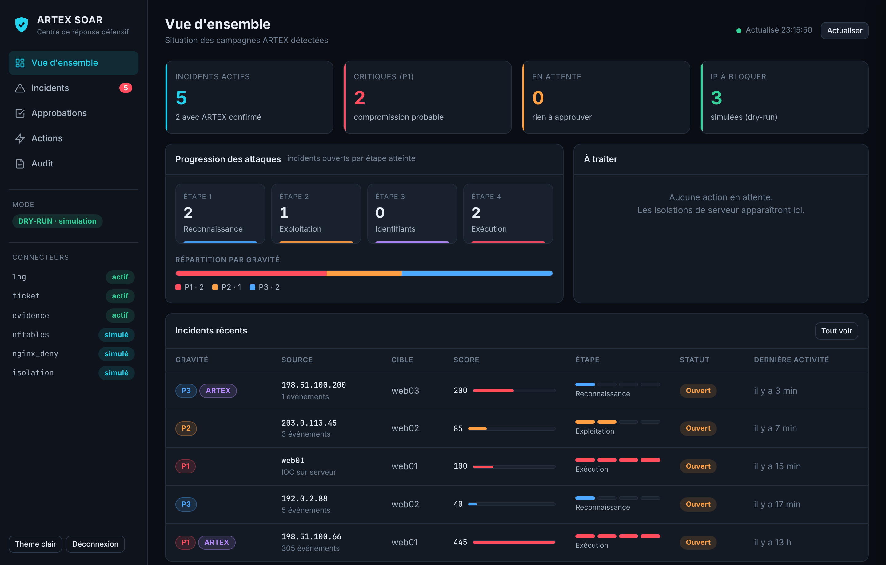
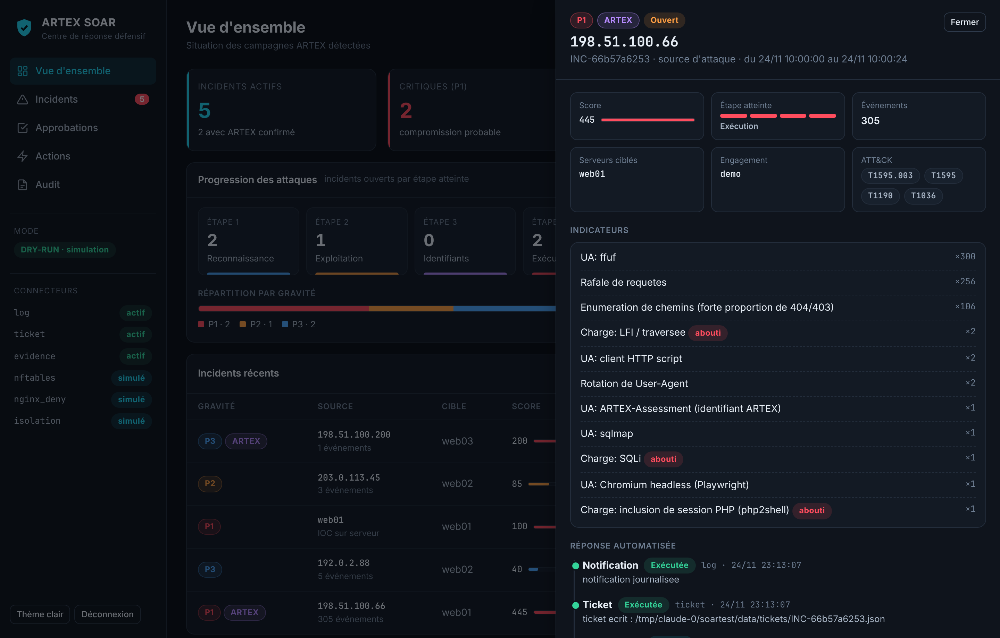

# ARTEX SOAR

Plateforme **SOAR** (orchestration et réponse automatisées) open source pour répondre aux
campagnes menées avec ARTEX. Elle s'appuie sur le kit de ce dépôt (`tools/artex_triage.py`,
règles Suricata/Sigma/YARA, `playbook/PLAYBOOK.md`) et le rend automatique :

1. **Ingestion** : journaux web (nginx/Apache), alertes Suricata EVE, rapports `artex_triage.py`,
   événements JSON de votre SIEM/WAF.
2. **Détection** : signatures d'`artex_triage.py` (réutilisées telles quelles), identifiants ARTEX
   (UA `ARTEX-Assessment/1.0`, en-têtes `X-ARTEX-*`, SID 9100001-9100019), signaux comportementaux
   (rafales, énumération, rotation d'UA, brute force) qui résistent au changement d'UA.
3. **Corrélation** : un incident par source, qualifié P3 / P2 / P1 comme dans le playbook. Un IOC
   trouvé sur un serveur fait passer en P1 les sources qui l'ont attaqué.
4. **Réponse** : playbooks YAML qui déclenchent des connecteurs (blocage pare-feu/WAF, isolation,
   collecte de preuves, ticket, notification), avec garde-fous et approbation humaine.

> **Strictement défensif.** Toutes les actions s'appliquent à votre infrastructure. Le SOAR ne
> scanne pas, ne contacte pas et n'attaque pas la source. Il n'existe aucun connecteur offensif
> et il ne faut pas en ajouter.



## Sécurité par défaut

| Garde-fou | Effet |
|---|---|
| `mode: dry_run` (défaut) | Aucun blocage ni isolation réel, même après approbation : la commande prévue est journalisée. |
| `dry_run: true` sur chaque connecteur perturbateur | Il faut **à la fois** `mode: enforce` et `dry_run: false` pour agir. |
| `protected_networks` | Ces réseaux ne sont jamais bloqués (passerelles, DNS, supervision, VPN admin). |
| `authorized_sources` / `authorized_engagements` | Pentests autorisés : incident marqué `authorized`, notification seule. |
| `max_blocks_per_hour` | Au-delà, chaque blocage attend une approbation (protège d'un emballement). |
| `inventory.hosts` + approbation | L'isolation ne vise qu'un serveur de votre inventaire et exige toujours un humain. |
| Commandes sans shell | Arguments validés (IP, nom d'hôte), `subprocess` sans `shell=True`. |
| Audit | Chaque décision (moteur, garde-fou, analyste) est tracée dans `/api/v1/audit`. |

## Démarrage rapide

### Essai hors ligne (aucun effet de bord)

```bash
cd soar
pip install -r requirements.txt
python -m artex_soar replay ../samples/access_demo.log --target web01
```

Résultat attendu : un incident **P1 ARTEX** pour `198.51.100.66` (ffuf, sqlmap, LFI puis inclusion
`sess_*` réussie), les commandes `nft` qui *seraient* lancées, et l'isolation refusée tant que
`web01` n'est pas dans l'inventaire. Le visiteur légitime `192.0.2.10` ne déclenche rien.

### Docker Compose

```bash
cd soar
cp .env.example .env          # changez SOAR_API_KEY
docker compose up -d --build
# Tableau de bord : http://127.0.0.1:8080  (saisir la clé API)

# Envoyer un journal
curl -X POST -H "X-API-Key: $SOAR_API_KEY" --data-binary @../samples/access_demo.log \
     "http://127.0.0.1:8080/api/v1/ingest/access-log?target=web01"

# Optionnel : agent qui suit /var/log/nginx/access.log en continu
docker compose --profile shipper up -d
```

## Utilisation au quotidien

- **Tableau de bord** (`http://127.0.0.1:8080`) : thème sombre de type SOC (thème clair disponible), adapté au mobile.
  - *Vue d'ensemble* : indicateurs clés (incidents actifs, P1, décisions en attente, IP bloquées ou à bloquer),
    progression des attaques par étape, répartition par gravité, actions à traiter, incidents récents.
  - *Incidents* : filtres (actifs, P1/P2/P3, ARTEX confirmé, clos) et recherche. Un clic ouvre le détail :
    score, étape atteinte, techniques ATT&CK, indicateurs (ceux qui ont abouti sont signalés), chronologie
    de la réponse avec les commandes exécutées ou simulées, requêtes observées, boutons Clore / Faux positif.
  - *Approbations* : boutons Approuver / Rejeter pour les actions sensibles (isolation).
  - *Actions* et *Audit* : historique complet, filtrable.

  
- **API** : documentation interactive sur `/docs`. Clé dans `X-API-Key`, nom de l'analyste dans
  `X-SOAR-User` (repris dans l'audit).

| Méthode | Chemin | Rôle |
|---|---|---|
| GET | `/health` | état, mode, connecteurs (et s'ils sont en dry-run), playbooks |
| POST | `/api/v1/ingest/access-log?target=web01` | lignes de journal combined (texte brut) |
| POST | `/api/v1/ingest/suricata` | EVE JSON (une alerte par ligne ou tableau) |
| POST | `/api/v1/ingest/triage` | rapport JSON de `artex_triage.py logs` ou `host` |
| POST | `/api/v1/events` | événements normalisés (voir `docs/ARCHITECTURE.md`) |
| GET | `/api/v1/incidents[?status=open]` | liste des incidents |
| GET | `/api/v1/incidents/{id}` | détail + actions |
| POST | `/api/v1/incidents/{id}/status` | `{"status": "closed" \| "false_positive" \| "authorized" \| "open"}` |
| GET | `/api/v1/actions[?status=pending_approval]` | actions |
| POST | `/api/v1/actions/{id}/approve` · `/reject` | décision humaine |
| GET | `/api/v1/audit` | journal d'audit |

## Playbooks fournis (`config/playbooks.yml`)

| Playbook | Déclencheur | Actions |
|---|---|---|
| `pentest-autorise` | source/engagement autorisé | notification |
| `p3-reconnaissance` | P3, score ≥ 60 | notification, ticket |
| `p3-artex-confirme` | identifiant ARTEX vu | blocage 24 h (nftables + liste nginx) |
| `p2-exploitation` | P2 (charge aboutie, brute force) | ticket, blocage 7 jours, notification |
| `p1-compromission` | P1 (php2shell réussi, webshell, IOC hôte) | preuves d'abord, alerte, isolation **sur approbation** |

## Documentation

- [`docs/ARCHITECTURE.md`](docs/ARCHITECTURE.md) : composants, modèle de données, qualification P1/P2/P3, écrire un connecteur.
- [`docs/DEPLOIEMENT.md`](docs/DEPLOIEMENT.md) : mise en production, passage en mode enforce, intégration Suricata / SIEM / cron.

## Tests

```bash
pip install -r requirements-dev.txt
python -m pytest
```
