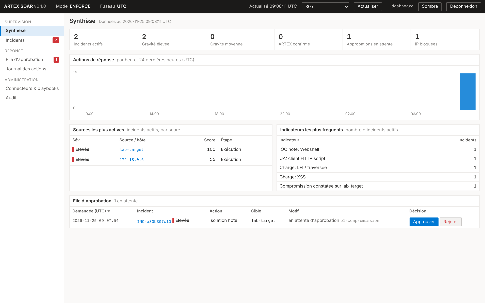

# Labo : lancer ARTEX contre ta propre cible et regarder le SOAR répondre

Ce labo tourne entièrement sur ton PC, avec Docker. Il contient quatre éléments :

- **lab-target** : une petite boutique **volontairement vulnérable** (LFI, injection SQL, XSS,
  mot de passe faible, IDOR). C'est la seule cible autorisée du test.
- **soar** : ARTEX SOAR et son tableau de bord.
- **shipper** : envoie au SOAR le journal d'accès de la cible.
- **hunter** : cherche toutes les 10 secondes des traces de compromission sur la cible
  (webshell, session PHP piégée).

Dans ce labo, la réponse est **réelle mais limitée à la cible** :

- un **blocage** fait répondre la cible `403` à l'IP d'ARTEX, en 2 à 3 secondes ;
- une **isolation**, que tu dois approuver, fait répondre la cible `503` à tout le monde.

Le pare-feu de ton PC n'est jamais modifié : le SOAR affiche seulement la commande qu'il aurait
lancée.

> ⚠️ Ne pointe ARTEX **que** sur `lab-target`. Ne mets pas la cible en ligne : elle n'écoute que
> sur ton PC (`127.0.0.1`).

## 1. Démarrer le labo (Windows)

Ouvre **PowerShell** (touche Windows, tape `powershell`, Entrée), puis tape ces commandes une par
une :

```powershell
cd $HOME\blue-team-against-artex      # le dossier où tu as cloné le dépôt
git pull
cd soar\lab
docker compose up -d --build
```

Le premier démarrage prend quelques minutes. Pour vérifier que tout tourne :

```powershell
docker compose ps
```

Tu dois voir `soar`, `lab-target`, `shipper` et `hunter` avec l'état **Up**.

- Tableau de bord : <http://127.0.0.1:8080>, avec la clé API `labo-artex`.
- La boutique : <http://127.0.0.1:8081>. Tu peux la visiter normalement, cela ne déclenche rien.

## 2. Brancher ARTEX sur le réseau du labo

ARTEX doit attaquer depuis sa propre adresse, sinon le SOAR bloquerait aussi ton navigateur.

**Si ARTEX tourne dans Docker** (cas habituel, avec `docker compose` dans le dossier d'ARTEX) :

```powershell
docker ps --format "{{.Names}}"
```

Repère le conteneur d'ARTEX (par exemple `artex-artex-1`), puis :

```powershell
docker network connect artex-lab artex-artex-1
```

Dans ARTEX, la cible est alors : **`http://lab-target/`**

**Si ARTEX tourne directement sous Windows** (`artex.exe`) : utilise la cible
`http://127.0.0.1:8081/`. Le test fonctionne, mais le blocage visera l'adresse de ton PC vue par
Docker, donc ton navigateur sera bloqué lui aussi. Pour lever le blocage, voir l'étape 5.

## 3. Lancer l'attaque

Dans ARTEX, crée une mission dont le **périmètre se limite à `lab-target`** (ou à
`127.0.0.1:8081`). Lance ensuite une reconnaissance web, puis des tests d'injection.

Sur le tableau de bord, en actualisant toutes les 30 secondes :

1. Un incident apparaît pour l'IP d'ARTEX, avec les indicateurs reconnus (UA ARTEX, LFI, SQLi…).
2. Dès qu'ARTEX est reconnu, ou qu'une exploitation est vue, l'IP est **bloquée**. Le compteur
   « IP bloquées » passe à 1 et ARTEX ne reçoit plus que des `403`.
3. Si ARTEX a eu le temps de déposer quelque chose (webshell, session piégée), le hunter le voit.
   Un incident **Élevée** s'ouvre sur `lab-target`, les preuves sont collectées et une
   **isolation** attend ta décision dans « File d'approbation ».
4. Clique sur **Approuver** : la boutique répond `503 - Serveur isolé par ARTEX SOAR (labo)`.



### Voir toute la chaîne sans bloquer

En mode `enforce`, ARTEX est souvent bloqué avant d'aller loin. Pour voir jusqu'où il irait
pendant que le SOAR **simule** ses réponses :

```powershell
$env:SOAR_MODE="dry_run"; docker compose up -d
```

Pour revenir au mode réel :

```powershell
$env:SOAR_MODE="enforce"; docker compose up -d
```

## 4. Où trouver les traces

```powershell
docker compose logs soar --tail 50          # décisions du moteur
docker compose logs hunter --tail 20        # IOC trouvés sur la cible
docker compose exec soar ls data/evidence   # dossiers de preuves (avec empreintes SHA-256)
```

## 5. Remettre à zéro

Cette commande efface les incidents, les blocages, l'isolation et le journal :

```powershell
docker network disconnect artex-lab artex-artex-1   # si tu l'avais branché
docker compose down -v
```

Ensuite, `docker compose up -d` repart d'un labo propre.

## Ce que le labo ne teste pas

- Le pare-feu réel (`nftables`) : il reste en simulation, car c'est ton PC.
- La force brute SSH et les scans de ports : la cible n'a ni SSH ni journal de pare-feu. Ces
  détections sont couvertes par les tests automatiques (`soar/tests/test_coverage.py`).

La liste complète des attaques d'ARTEX et de leur couverture se trouve dans
[docs/COUVERTURE-ARTEX.md](../docs/COUVERTURE-ARTEX.md).
